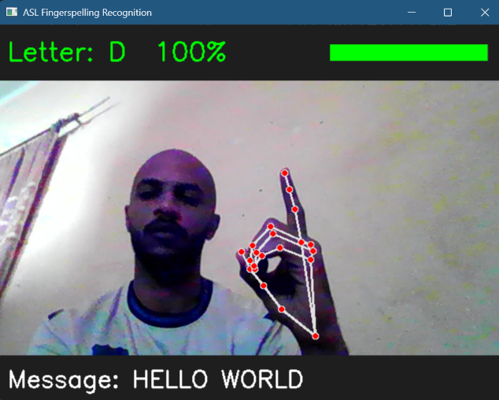

# ASL Fingerspelling Recognition ✋

Real-time **American Sign Language (ASL) fingerspelling** recognition using a webcam.
The app detects hand landmarks with **MediaPipe**, classifies the letter with a **neural network (MLP)**, and builds a text message from the signs.



---

## Features

- Real-time hand tracking (21 landmarks per hand) with MediaPipe
- Recognizes **24 static ASL letters** (A–Y, excluding J and Z) plus a "nothing" class
- Shows the predicted letter and model confidence live
- **Stable prediction** logic: a letter is only added after it is held steadily, to avoid flickering
- Builds a message from the signed letters (with space, delete and clear controls)
- Custom dataset collected with an easy one-person recording tool

---

## How It Works

```
Webcam frame → MediaPipe Hands → 21 landmarks (x, y, z)
            → Normalization (wrist-centered, scale-invariant)
            → MLP classifier → Letter + confidence
            → Stability check (15 frames) → Message
```

Because the model uses **hand landmarks instead of raw images**, it is lightweight, trains in seconds on a CPU, and is robust to background and lighting changes.

---

## Project Structure

```
ASL_Project/
├── Data/
│   └── landmarks.csv      # Collected landmark dataset
├── Models/
│   └── asl_model.pkl      # Trained model
├── test_camera.py         # Test webcam + hand tracking
├── collect_data.py        # Record landmark data for each letter
├── utils.py               # Landmark normalization
├── train.py               # Train and evaluate the model
├── app.py                 # Real-time recognition app
└── requirements.txt
```

---

## Dataset

- Collected using `collect_data.py` with a laptop webcam
- **~7,600 samples** across 25 classes (24 letters + NOTHING), ~300 per class
- Each sample = 21 hand landmarks × (x, y, z) = **63 features**
- Recorded at different distances, angles and positions for variety

---

## Model & Results

| Item | Value |
|------|-------|
| Model | MLPClassifier (128 → 64 hidden units) |
| Input | 63 normalized landmark features |
| Train / Test split | 80% / 20% (stratified) |
| Test accuracy | 100% |

> Note: the test split comes from the same recording sessions, so this score is optimistic. Live testing showed reliable real-time performance.

---

## Installation

**Requirements:** Python 3.10 – 3.12

```bash
git clone https://github.com/Abdelilahibe/ASL_Project.git

python -m venv venv
venv\Scripts\activate          # Windows
# source venv/bin/activate     # Mac / Linux

pip install -r requirements.txt
```

---

## Usage

**Run the app (pre-trained model included):**
```bash
python app.py
```

| Key | Action |
|-----|--------|
| Hold a sign | Add letter to message |
| `Space` | Add a space |
| `Backspace` | Delete last letter |
| `0` | Clear message |
| `Esc` | Quit |

To repeat a letter (e.g. the double L in "HELLO"), relax or drop your hand briefly between signs.

**Collect your own data:**
```bash
python collect_data.py
```
Press a letter key → 3-second countdown → 100 samples are recorded automatically. Press `1` for the "nothing" class.

**Retrain the model:**
```bash
python train.py
```

---

## Future Work

- Support dynamic letters **J** and **Z** using a sequence model (LSTM)
- Evaluate on a separate test session and multiple signers
- Word suggestions / auto-complete
- Text-to-speech for the final message
- Web or desktop GUI

---

## Tech Stack

Python · OpenCV · MediaPipe · scikit-learn · NumPy · pandas

---

## Author

**Abdelilah**
Feel free to connect or open an issue for suggestions!
